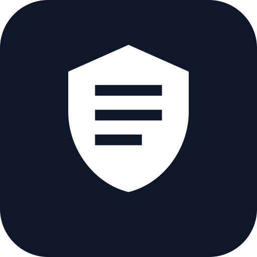
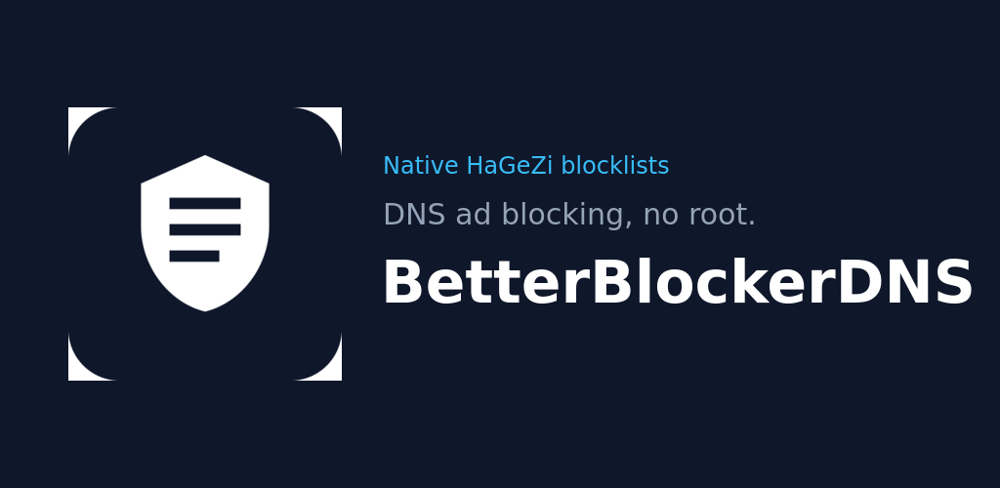
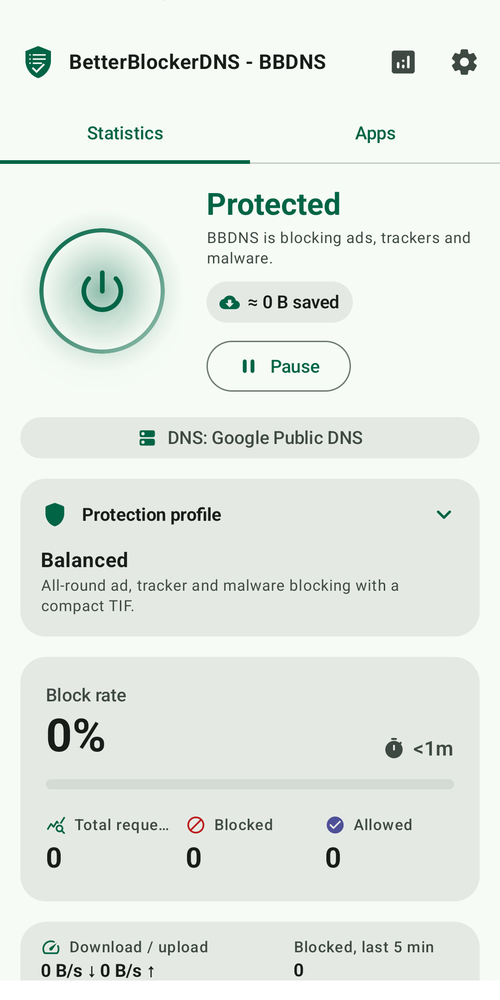
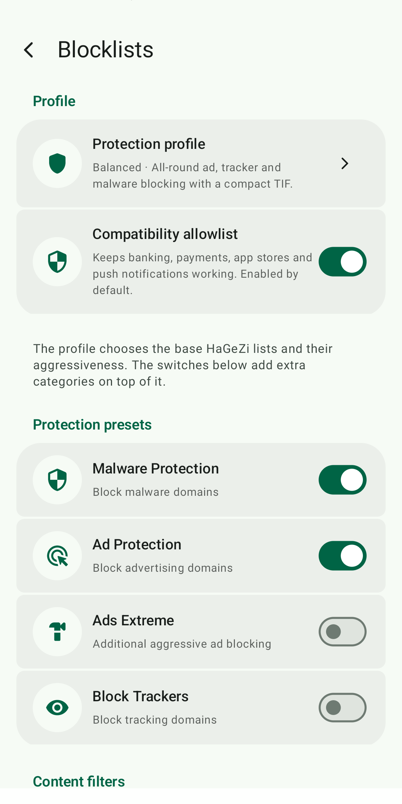
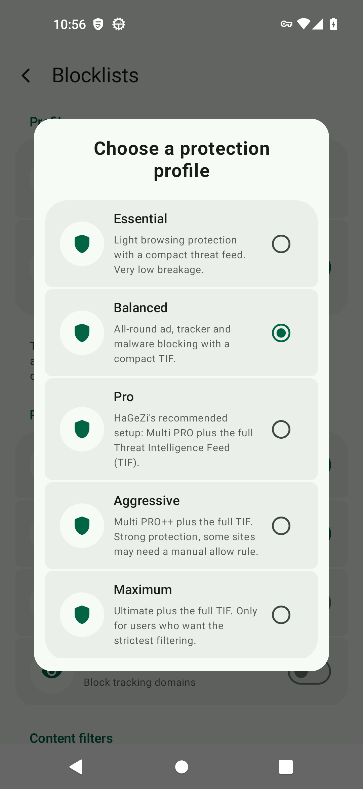
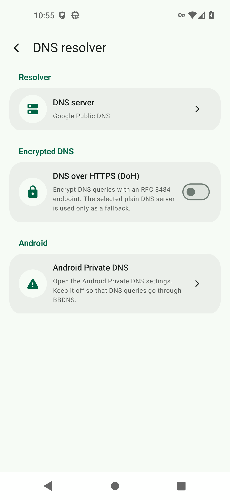
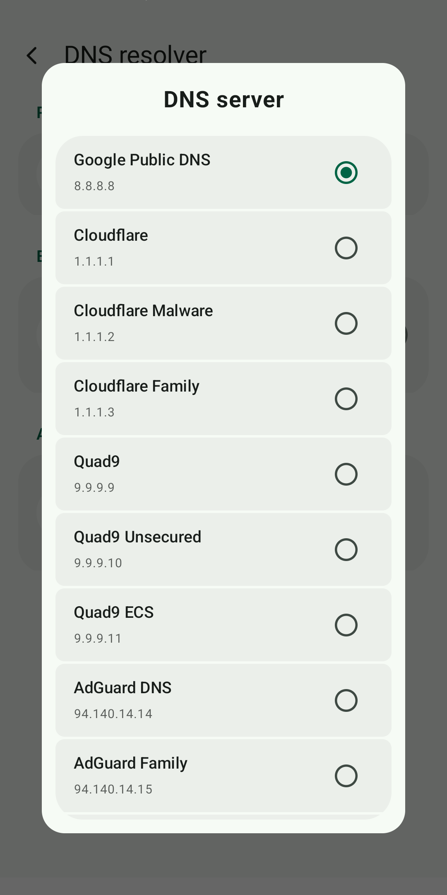
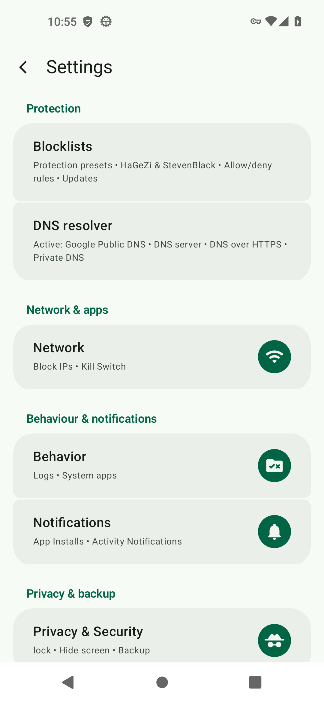

<p align="center">
  
</p>

<h1 align="center">BetterBlockerDNS (BBDNS)</h1>

<p align="center">
  <b>A free, open-source DNS ad blocker for Android.</b><br>
  Blocks ads, trackers, malware, phishing and unwanted content in every app, through a local VPN.<br>
  No root, no account, no analytics.
</p>

<p align="center">
  <a href="https://github.com/buzzqw/BetterBlockerDNS/releases/latest"></a>
  <a href="https://github.com/buzzqw/BetterBlockerDNS/actions/workflows/build.yml"></a>
  <a href="https://www.gnu.org/licenses/gpl-3.0.html"></a>
  
  <a href="https://ko-fi.com/buzzqw"></a>
  <a href="https://www.paypal.com/donate/?business=azanzani%40gmail.com&item_name=BetterBlockerDNS"></a>
</p>

<p align="center">
  
</p>

BBDNS is easy enough for everyday use: pick a protection profile and turn it on.
Anyone who wants more can tune every list, rule, resolver and app.

**Contents:**
[Install](#install) ·
[Getting started](#getting-started) ·
[Features](#features) ·
[How it works](#how-it-works) ·
[Privacy](#privacy-and-permissions) ·
[Battery](#performance-and-battery-life) ·
[Troubleshooting](#troubleshooting) ·
[Build](#building-from-source) ·
[Contributing](#contributing)

---

## Screenshots

<p align="center">
  
  
  
</p>
<p align="center">
  
  
  
</p>

---

## Install

Download `BetterBlockerDNS-<version>.apk` from the
[latest release](https://github.com/buzzqw/BetterBlockerDNS/releases/latest)
and open it on your phone (Android 7.0 or newer). Allow installing from your
browser or file manager when Android asks.

Official APKs are built by GitHub Actions from the tagged source and signed
with the project key. Updates install over the previous version and keep your
settings.

## Getting started

1. **Open BBDNS and tap the power button.** Android asks to allow a VPN
   connection: accept it. The VPN is local and your traffic never leaves the
   phone through a BBDNS server, because there is none.
2. **Choose a protection profile.** *Pro* is recommended. *Essential* and
   *Balanced* break fewer sites; *Aggressive* and *Maximum* block more.
3. **Keep protection always on.** Open the tip on the home screen to enable
   *Always-on VPN* and remove the battery restrictions for BBDNS. Otherwise
   some phones (Xiaomi, Samsung, Huawei, OnePlus…) stop it in the background.
4. **If a site or app stops working,** open *Recently blocked* on the home
   screen, tap the domain and allow it. You can undo it from the message that
   appears at the bottom.

---

## Features

### Blocking
- **Native [HaGeZi](https://github.com/hagezi/dns-blocklists) catalogue**:
  - Multi LIGHT, NORMAL, PRO, PRO mini, PRO++, PRO++ mini, ULTIMATE, ULTIMATE mini;
  - Threat Intelligence Feeds (full, medium, mini);
  - Fake, Pop-Up Ads, DynDNS, Badware Hoster, Most Abused TLDs;
  - DoH / VPN / Tor / Proxy Bypass, URL Shortener, Anti-Piracy;
  - Native Trackers (Apple, Samsung, Xiaomi, TikTok);
  - No Safesearch, NSFW, Gambling, Social Networks.
- **Native [StevenBlack](https://github.com/StevenBlack/hosts) catalogue**:
  the unified hosts file plus the fakenews, gambling, porn and social
  extensions.
- **One-tap protection profiles**: Essential, Balanced, Pro (recommended),
  Aggressive and Maximum. A profile only manages the HaGeZi Multi/TIF group,
  so your extra lists are kept.
- **Compatibility allowlist** for banking, payments, public administration,
  app stores, push notifications and captive portals. Rules also cover
  subdomains: `paypal.com` includes `www.paypal.com`.
- **Custom lists and rules**: hosts, ABP, DNSMasq, wildcard, regex and plain
  domains, plus your own allow and block rules.
- **Automatic list updates**, every 6 hours to once a week.

### DNS
- **DNS over HTTPS (RFC 8484)** with a built-in catalogue: Cloudflare
  (standard, security, family), Google, Quad9 (standard, unsecured, ECS),
  AdGuard (standard, family), DNS.SB, Control D (standard, malware, ads,
  family), DNSBunker, DNS4EU (unfiltered, protective, child, no ads,
  child + no ads), or your own endpoint.
- **Plain DNS resolvers**: Google, Cloudflare, Quad9, AdGuard, OpenDNS,
  CleanBrowsing, DNS.SB, Control D, DNS4EU and Yandex, in their standard and
  filtered variants, or your own servers.

### Control
- **Per-app rules**: block Wi-Fi or mobile data for a single app, let an app
  bypass the VPN, or skip only its DNS filtering.
- **Quick exclusions** for banking apps, system apps and Google services.
- **Block when the screen is off**, separately for Wi-Fi and mobile data.
- **Pause** protection for 15 minutes or more from the home screen, the
  notification or an automation app.
- **Logs and statistics**: block rate, top blocked domains and apps, 30-day
  history, and "why was this blocked?" for any domain. Turn on *Detailed logs*
  for full hostnames, ports and endpoints.

### Everyday use
- **Quick Settings tile** and **home screen widget** to see the status and
  start, stop or resume protection with one tap.
- **Automation intents** for Tasker, MacroDroid, Home Assistant or `adb`; see
  [Automation](docs/AUTOMATION.md).
- **App lock** with password, pattern or fingerprint, backup and restore, Material 3
  theming with dynamic colours and AMOLED black.
- **Languages**: English, Italian, German, Spanish, French, Brazilian
  Portuguese and Simplified Chinese.

---

## How it works

BBDNS creates a **local VPN** on the phone. Android sends all traffic through
it, and the packet engine (written in C, from NetGuard) handles it on the
device:

1. **DNS queries** are checked against the enabled lists and your rules. A
   blocked domain gets an empty answer, so the app never connects to it. An
   allowed query goes to the resolver you chose, over HTTPS when DoH is on.
2. **New connections** are checked against the per-app, IP and screen-off
   rules. Packets of an accepted connection then pass straight through.
3. **When a rule changes**, the open connections are closed, so the new rule
   applies immediately.

Only one VPN can be active on Android at a time: BBDNS cannot run together
with another VPN app.

## Privacy and permissions

- Filtering happens **on the phone**. BBDNS has no servers, accounts, ads,
  analytics or crash reporting.
- The only network requests BBDNS makes itself are **DNS queries** to the
  resolver you choose and **list downloads** from the sources you enable.
- Logs and statistics stay on the device; you can turn logs off or clear them.

| Permission | Why |
|---|---|
| VPN (asked by Android) | filter traffic on the device |
| Internet, network state | forward DNS and traffic, download lists, detect Wi-Fi/mobile |
| Query all packages | show your apps for per-app rules |
| Foreground service, notifications | keep protection running and show its status |
| Start at boot | restart protection after a reboot |
| Ignore battery optimisations | stop Android from killing the VPN in the background |
| Biometric | optional app lock |

---

## Performance and battery life

Always-on protection must not drain the battery, so every layer is optimised:

- **Native packet engine.** The data path runs in C. Only DNS queries and the
  first packet of each new TCP or UDP connection reach the Kotlin rule engine.
  Streaming, calls, games and QUIC traffic are forwarded without a JNI call per
  packet.
- **One lookup per connection.** The app that owns a connection is resolved
  once and cached, and non-DNS traffic is logged once per connection.
- **Compact blocklist index.** Lists are compiled into 64-bit hash sets, suffix
  sets, TLD sets and pre-compiled regexes. Millions of rules fit in little
  memory and each lookup is instant. Unchanged lists are not reloaded.
- **Quiet with the screen off.** The protection and speed notifications stop
  refreshing, and the home screen stops sampling CPU, battery and history in
  the background.
- **DNS over HTTPS cache.** Answers are reused for 60 seconds and connections
  are kept alive, so repeated queries avoid a new TLS handshake.
- **Light logging.** Release builds write only warnings and errors to the
  system log.

The home screen can show live CPU and battery usage, so you can check the real
cost of protection at any time.

---

## Troubleshooting

**A site or app does not work.** Allow the blocked domain from *Recently
blocked* on the home screen, or from the log. *Why was this blocked?* shows
the list that blocked it. A less aggressive profile also helps.

**Protection turns off by itself.** Enable *Always-on VPN* for BBDNS in
Android settings and remove its battery restrictions; see
[dontkillmyapp.com](https://dontkillmyapp.com) for your phone brand.

**Ads still appear.** Turn off *Private DNS* in Android settings, because it
bypasses the VPN's DNS. Some ads come from the same domains as the content
(YouTube, for example) and cannot be blocked by DNS.

**"Another VPN took over."** Android allows only one VPN. Turn BBDNS back on
when you are done with the other VPN.

**Banking or payment app problems.** Keep the compatibility allowlist on, or
use *Quick exclusions → Banking apps*.

---

## Building from source

Requirements: JDK 17 or newer, Android SDK 36 (minSdk 24), Android NDK
27.0.12077973 and CMake 3.22.1. On Debian or Ubuntu,
`scripts/setup_android_sdk.sh` installs all of them.

```bash
./gradlew :app:assembleDebug     # debug APK
./gradlew :app:assembleRelease   # release APK (debug-signed without a keystore)
./gradlew :app:lintDebug         # lint
```

The APK is written to `app/build/outputs/apk/`. Release signing reads
`BBDNS_KEYSTORE`, `BBDNS_KEYSTORE_PASSWORD`, `BBDNS_KEY_ALIAS` and
`BBDNS_KEY_PASSWORD` from the environment; without them the build falls back
to debug signing, which is what F-Droid and other external builders use.

### Continuous integration and releases

- Every commit is built by the **Build** workflow. Its APK is for verification
  only and is never published.
- The version lives in `version.properties`. To release, run
  `./gradlew bumpVersion`, add the notes to `CHANGELOG.md`, commit, and push a
  tag such as `v1.0.34`.
- The **Release** workflow then builds the APK signed with the project key,
  checks the signing certificate and the version, and publishes the GitHub
  release with the notes of that version.
- Once the release is published, `scripts/email_release_link.sh` emails the
  maintainer the link to it and its notes, without attachments.
- `scripts/build_release.sh` builds the same signed package locally, only when
  it is needed for tests, and emails it as a ZIP. It reads the signing
  settings from `~/.config/bbdns/release.env`. Keep the keystore outside the
  repository and back it up.

### Project structure

```
app/src/main/
├── cpp/                  # native packet engine (sessions, TCP/UDP/ICMP)
└── java/com/buzzqw/bbdns/
    ├── core/             # logging, utilities, constants
    ├── data/             # database, cache, repositories, services
    ├── domain/           # models, use cases, managers
    ├── presentation/     # Compose UI, navigation, ViewModels
    │   └── screens/settings/subSettings/dns/
    │       ├── hosts/    # blocklist parser and rule database
    │       └── lists/    # HaGeZi + StevenBlack catalogues, profiles, allowlist
    └── service/          # VPN, firewall rules, tile, widget, notifications
```

---

## Contributing

- **Bugs and ideas:** open an [issue](https://github.com/buzzqw/BetterBlockerDNS/issues/new/choose)
  with your Android version, phone model and BBDNS version.
- **Translations:** strings live in `app/src/main/res/values-<language>/strings.xml`.
  Corrections and new languages are welcome as pull requests.
- **Code:** keep the build and `./gradlew :app:lintDebug` free of errors, and
  add a user-facing entry to `CHANGELOG.md`.

## Security

Found a security issue? **Do not open a public issue.** Report it privately via
[GitHub Security Advisories](https://github.com/buzzqw/BetterBlockerDNS/security/advisories/new)
or email **azanzani@gmail.com** with `[BBDNS SECURITY]` in the subject. See
[SECURITY.md](.github/SECURITY.md) for the supported versions, scope and
coordinated-disclosure policy.

## Support the project

BBDNS is free and has no paywall. If it is useful to you, you can support
development:

- **PayPal**: [Donate with PayPal](https://www.paypal.com/donate/?business=azanzani%40gmail.com&item_name=BetterBlockerDNS)
- **Ko-fi**: [ko-fi.com/buzzqw](https://ko-fi.com/buzzqw)

## License

BBDNS is distributed under the **GNU General Public License v3.0**. The native
packet engine derives from [NetGuard](https://github.com/M66B/NetGuard) by
Marcel Bokhorst, and the copyright notices of the original authors are kept in
the source files. The HaGeZi and StevenBlack lists keep their own licenses and
attribution requirements.

- GPLv3: <https://www.gnu.org/licenses/gpl-3.0.html>
- HaGeZi DNS Blocklists: <https://github.com/hagezi/dns-blocklists>
- StevenBlack hosts: <https://github.com/StevenBlack/hosts>
